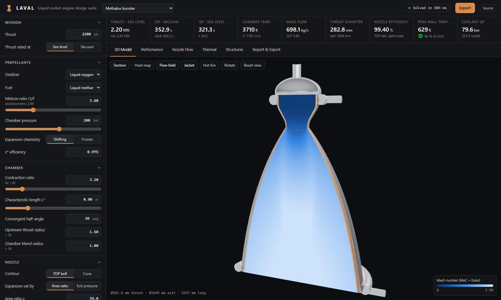
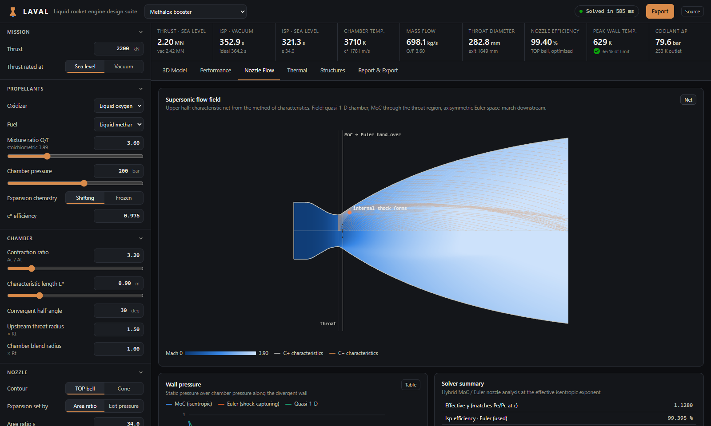
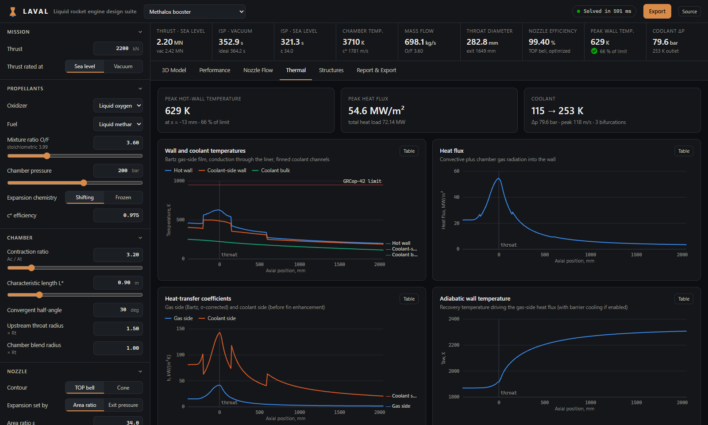
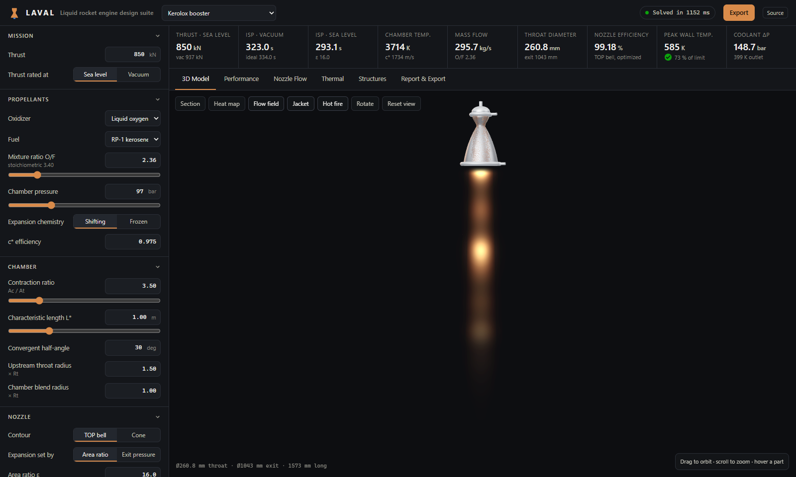
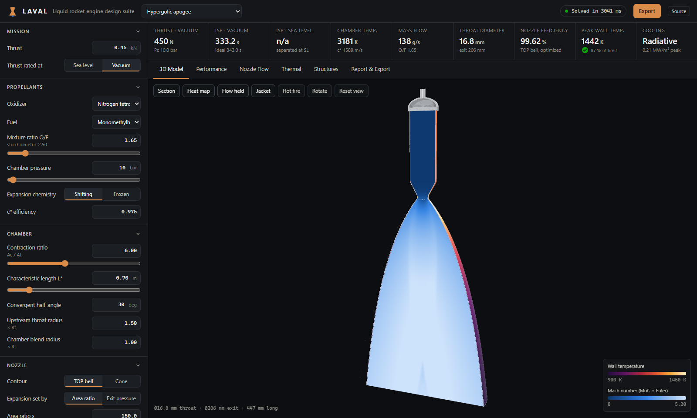
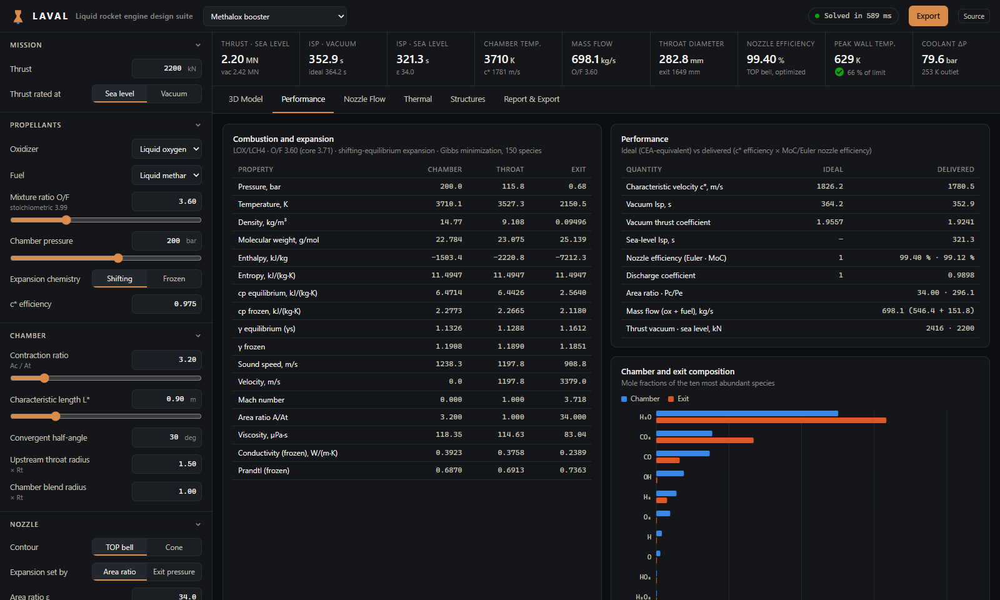
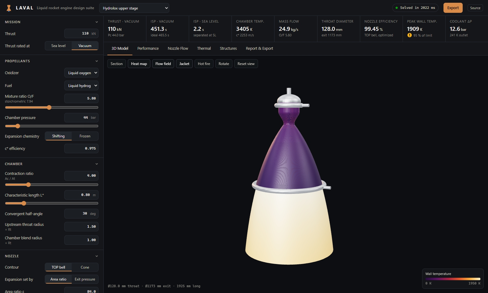

# Laval: liquid rocket engine design suite

**From propellant chemistry to a 3D-printable regeneratively cooled thrust chamber, in the browser.**

Laval designs a complete liquid rocket thrust chamber from a handful of requirements (propellants, thrust, chamber pressure). It solves the combustion chemistry, sizes the chamber, optimizes and analyzes the supersonic nozzle flow, designs the regenerative cooling channels, checks structural margins, and generates a watertight solid model you can export to STL or DXF. Every stage is a physics model written from the governing equations and verified against reference solutions: NASA CEA, exact gas-dynamics solutions, and CoolProp.



## What happens when you press a key

```
Propellants, O/F, Pc, thrust
        │
        ▼
 Chemical equilibrium ─── Gibbs minimization over 150 species (NASA RP-1311 algorithm)
        │                 shifting-equilibrium or frozen expansion, c*, Isp, Cf
        ▼
 Throat sizing ────────── thrust target → At, mass flow, exit area
        │
        ▼
 Nozzle aerodynamics ──── method of characteristics through the throat
        │                 → shock-capturing Euler space-march to the exit
        │                 → Nelder-Mead optimization of the thrust-optimized parabola
        ▼
 Regenerative cooling ─── Bartz gas side · CoolProp coolant · finned channels that bifurcate
        │                 liner and jacket auto-sized for safety factors · barrier film
        │                 radiation-cooled nozzle extension
        ▼
 Solid model ──────────── watertight liner, instanced ribs, jacket, manifolds, injector
                          → STL · DXF · CSV · JSON
```

A complete design (chemistry, contour optimization with 30 to 60 full flow solutions, cooling and structures) solves in 0.5 to 2 seconds in a Web Worker, so the UI stays live while you drag sliders.

## Engineering depth

### Thermochemistry, as in NASA CEA, written from scratch
- Element-potential Newton iteration for Gibbs free-energy minimization (Gordon & McBride, NASA RP-1311), with the TP, HP and SP problems, the CEA step-size control, and analytic equilibrium derivatives for γs and the equilibrium sound speed.
- 150 C/H/O/N gas species with NASA-9 polynomials parsed from the NASA Glenn database (`thermo.inp`).
- Rocket problem: infinite-area combustor, sonic throat by Newton iteration on u = a, exit by area ratio or pressure, shifting equilibrium or frozen at the chamber.
- Transport properties from the NASA CEA fits with Wilke-type mixing and binary interaction viscosities, plus a Chapman–Enskog / Lennard-Jones fallback.

### Nozzle flow: two independent solvers
- **Method of characteristics**: axisymmetric interior, wall and axis unit processes with a second-order predictor–corrector. The compatibility relations are written in arc-length form so they stay finite as M → 1. Coalescing characteristics are detected and captured, which reproduces the internal shock that thrust-optimized parabolic bells are known for.
- **Euler space-march**: conservative finite-volume solver for the steady axisymmetric Euler equations, marched in x in a wall-fitted coordinate, with MUSCL reconstruction, Rusanov fluxes and a characteristic slip-wall condition. It takes over from the MoC once the flow is axially supersonic, captures internal shocks conservatively, and conserves mass to round-off.
- **Contour optimization**: the TOP parabola's inflection and exit angles are optimized directly against the flow solver. This recovers Rao's published design charts from first principles; for ε = 25 and an 80 % bell it gives θn = 32.4° and θe = 8.0°.

### Cooling and structures
- Counterflow channel-wall solver: Bartz correlation with the σ property correction and recovery temperature, conduction through the liner with k(T), and Dittus–Boelter / Sieder–Tate coolant convection with fin-efficiency ribs. Hydrogen uses a wall-to-bulk temperature-ratio correction.
- Coolant properties are tabulated from CoolProp's reference equations of state (1–700 bar), so supercritical methane and hydrogen are handled through their pseudo-critical spikes. Coolant heating is integrated in enthalpy, so the energy balance closes exactly.
- Channels bifurcate (the count doubles) when they would exceed a maximum width. The liner and closeout jacket are thickened station by station to target safety factors, iterating with the thermal solution because yield strength depends on temperature.
- Two-stream barrier (film) cooling: the fuel-rich wall layer's temperature comes from its own equilibrium solve, and the Isp penalty from unmixed streams is included.
- Radiation-cooled extensions and radiatively cooled engines use the wall energy balance h_g(T_aw − T_w) = εσT_w⁴.
- Checks for coking, boiling, material limits and injector pressure budget.

### CAD kernel
- Revolved shells with normal-offset layers, swept rib solids (one geometry per bifurcation level, instanced by rotation), auto-sized jacket, manifolds, injector plate, dome and element posts.
- Every body is verified watertight and outward-oriented in the test suite.
- Exports: binary STL (mm), layered DXF profile for a revolve feature in SolidWorks or Fusion, CSV contour, and a JSON design report.

## Verification

Each row is enforced by `npm test` (304 tests).

| Model | Reference | Result |
|---|---|---|
| Equilibrium chemistry & performance | NASA CEA via RocketCEA: 96 cases × shifting/frozen, 7 propellant pairs, 10–276 bar | Tc, Isp, c*, γ, sound speed, Pc/Pe, exit Mach within **0.02 %** |
| Combustion-gas transport | NASA CEA transport output | Viscosity, conductivity, Prandtl within 0.5 % |
| Method of characteristics | Exact conical source flow (10°, 15°, 20°) | Isp efficiency within 0.15 %; exit mass & momentum balance < 0.3 % |
| Euler space-march | MoC on shock-free nozzles | Agreement within 0.1 %; mass drift < 1e-12; grid-converged to 0.05 % with a shock |
| Bell optimizer | Rao's TOP charts | Optimal angles inside the published band; longer bells strictly better |
| Coolant properties | CoolProp | ρ within 1 %, cp within 3 % near the pseudo-critical line, μ and k within 2 % |
| Engine pipeline | Conservation laws | F = ṁ·Isp·g0 exactly; coolant Q = ṁΔh within 2 %; all five presets inside material limits |
| Solid model | Closed-manifold and volume checks | Watertight, outward-oriented bodies; mass within 6 % of the thermal model |

## Screenshots

| | |
|---|---|
|  **Nozzle flow**: characteristic net (upper half) over the Mach field, internal shock origin marked |  **Thermal**: wall and coolant temperatures, heat flux and transfer coefficients along the chamber |
|  **Hot fire**: plume colour from propellant chemistry, shock-cell spacing from the exit Mach number |  **Radiation-cooled apogee engine**: barrier-cooled niobium wall temperature with the flow field inside |
|  **Performance**: CEA-style state table, species, O/F and altitude sweeps |  **Hydrolox upper stage**: carbon-carbon extension at 1900 K above a hydrogen-cooled jacket |

## Presets

| Preset | Propellants | Thrust | Pc | Notable |
|---|---|---|---|---|
| Methalox booster | LOX / CH4 | 2.2 MN (SL) | 200 bar | 360 high-aspect-ratio channels, 3 bifurcations, 3 % barrier film |
| Kerolox booster | LOX / RP-1 | 850 kN (SL) | 97 bar | CuCrZr liner kept below the RP-1 coking limit |
| Hydrolox upper stage | LOX / LH2 | 110 kN (vac) | 44 bar | Regen to ε 45, radiation-cooled C/C extension to ε 84 |
| Student 5 kN ethanol | LOX / ethanol | 5 kN (SL) | 20 bar | Ideally expanded at sea level, supercritical ethanol coolant |
| Hypergolic apogee | N2O4 / MMH | 450 N (vac) | 10 bar | Fully radiation cooled, niobium wall with barrier cooling |

## Running it

```bash
npm install
npm run dev      # http://localhost:5173
npm test         # 304 verification tests
npm run build    # static production build in dist/
```

The reference data generators are only needed to rebuild the bundled data or the test fixtures:

```bash
pip install rocketcea CoolProp
node scripts/build-thermo.mjs path/to/thermo.inp        # NASA Glenn species
node scripts/build-transport.mjs path/to/trans.inp      # NASA transport fits
python scripts/reference/cea_reference.py               # CEA validation fixtures
python scripts/reference/build_fluid_tables.py          # coolant property tables
```

## Code map

```
src/core/                     pure TypeScript physics, no DOM
  thermo/                     species data, equilibrium, rocket performance, transport
  nozzle/                     contour, MoC, Euler space-march, hybrid analysis, optimizer
  thermal/                    regenerative / radiative cooling and structures, materials
  fluids/                     CoolProp coolant tables
  cad/                        mesh kernel, engine solid model, STL / DXF / CSV export
  design.ts                   end-to-end pipeline
src/worker/                   solver Web Worker
src/ui/                       React UI, Three.js viewer, SVG/canvas charts
tests/                        verification suite and reference fixtures
scripts/                      data and fixture generators
```

## Modelling assumptions

Laval is a preliminary-design tool. These assumptions are deliberate, and each one is the usual simplification at this stage of design:

- Ideal-gas combustion products without condensed phases (soot or ice), with an infinite-area combustor. Delivered performance applies a user c* efficiency.
- The nozzle flow is inviscid. Boundary-layer and kinetic losses are not included, and the flow solvers use the perfect-gas γ that reproduces the equilibrium exit pressure ratio.
- Bartz is an empirical correlation (typically ±20–30 % at the throat); a multiplier is exposed for calibration. Two-phase coolant boiling is flagged, not modelled.
- Stresses are analytic (channel-span plate bending, through-wall thermal stress, thin-shell hoop), not finite elements. Material data are representative handbook values.
- Injector sizing is first-order (orifice equation).

## References

1. Gordon & McBride, *Computer Program for Calculation of Complex Chemical Equilibrium Compositions and Applications*, NASA RP-1311 (1994)
2. McBride, Zehe & Gordon, *NASA Glenn Coefficients for Calculating Thermodynamic Properties of Individual Species*, NASA TP-2002-211556
3. Svehla, *Transport Coefficients for the NASA Lewis Chemical Equilibrium Program*, NASA TM-4647 (1995)
4. Rao, *Exhaust Nozzle Contour for Optimum Thrust*, Jet Propulsion 28 (1958)
5. Zucrow & Hoffman, *Gas Dynamics*, Vol. 2 (1977)
6. Kliegel & Levine, *Transonic Flow in Small Throat Radius of Curvature Nozzles*, AIAA Journal 7 (1969)
7. Bartz, *A Simple Equation for Rapid Estimation of Rocket Nozzle Convective Heat Transfer Coefficients*, Jet Propulsion 27 (1957)
8. Huzel & Huang, *Modern Engineering for Design of Liquid-Propellant Rocket Engines*, AIAA (1992)
9. Schmucker, *Flow Processes in Overexpanded Chemical Rocket Nozzles*, NASA TM-77396 (1984)
10. Bell, Wronski, Quoilin & Lemort, *CoolProp*, Ind. Eng. Chem. Res. 53 (2014)
